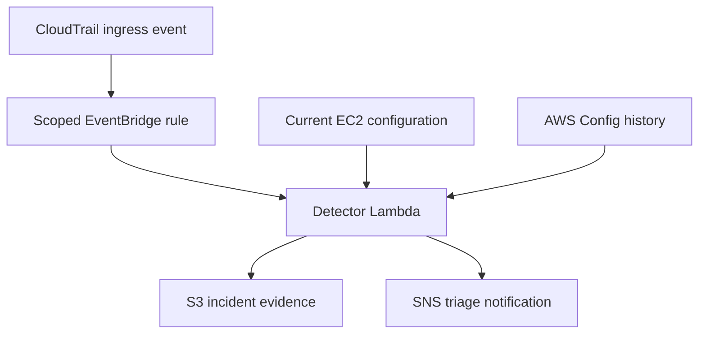
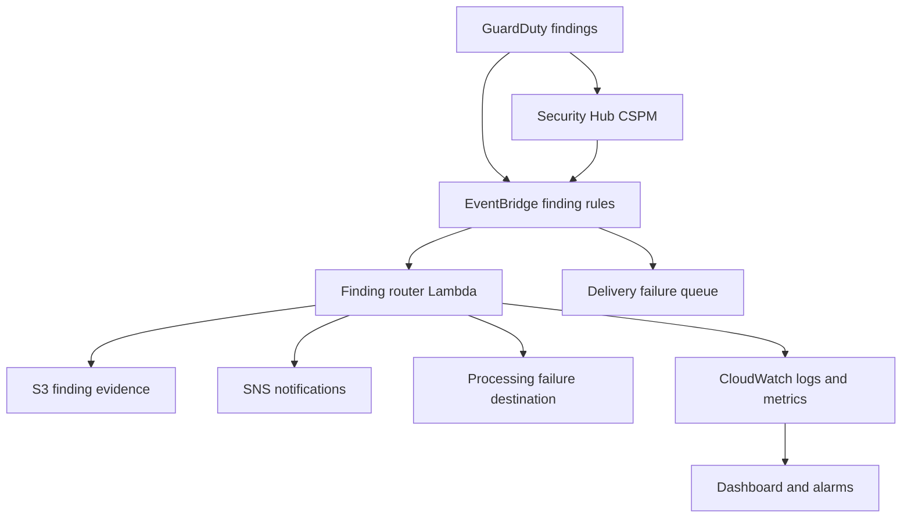
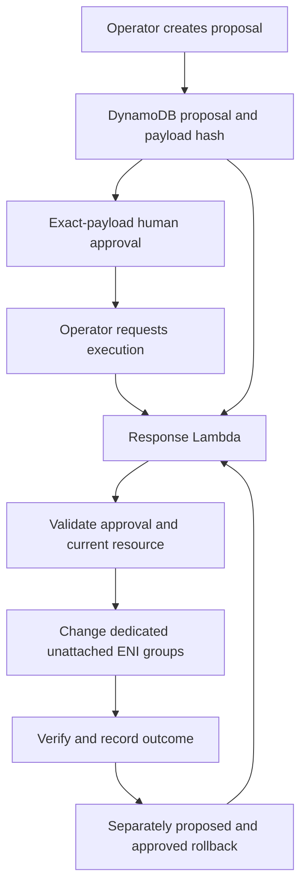

# AWS Cloud Security Detection and Response Lab

A Terraform-managed AWS sandbox demonstrating security event detection,
investigation, notification, and human-approved simulated response.

Built with CloudTrail, AWS Config, EventBridge, Lambda, GuardDuty,
Security Hub CSPM, CloudWatch, SNS, SQS, DynamoDB, and S3.

## Demonstrated capabilities

- Scoped CloudTrail event detection for security-group ingress changes.
- Investigation using current EC2 configuration and AWS Config history.
- Incident timelines and evidence files with SHA-256 verification.
- SNS triage notifications and operational alarms.
- GuardDuty and Security Hub sample-finding integration.
- Payload-bound approval for simulated quarantine and rollback.
- Denial of rejected and expired response approvals.
- Safe sequential repeat execution of a completed response.
- Processing-failure capture and controlled synthetic recovery.
- Monitoring dashboard and bounded workload validation.
- Offline CI checks and reproducible Lambda packaging.
- GitHub OIDC authentication for remote Terraform planning.
- Encrypted, versioned remote Terraform state with S3 locking.
- Evidence-backed mappings to selected NIST SP 800-53 controls.

## Architecture

### Detection and investigation



### Finding integration and operations



The delivery queue captures EventBridge target-delivery failures.
The processing destination captures failed asynchronous Lambda processing.
The processing recovery path was exercised with a synthetic fixture.

### Approved simulated response



Detection does not automatically invoke quarantine. The operator supplies
the incident reference when creating a response proposal.

## Selected observed results

| Exercise | Result |
| --- | --- |
| Public SSH classification | HIGH classification; 6.283 seconds from source event to classification in one test. |
| Benign comparison cases | Public HTTPS and private SSH produced INFO classifications. |
| Incident notification | Detection-to-SNS-publication latency: 3.274 seconds in one test. |
| GuardDuty routing | Router receipt-to-publication latency: 0.441 seconds. |
| Security Hub routing | Router receipt-to-publication latency: 0.320 seconds. |
| Response repeat | Returned `already_executed`; desired quarantine groups remained present. |
| Rollback | Baseline group restored; approval-to-verification latency: 12.936 seconds. |
| Rejected and expired approvals | Execution denied; baseline group unchanged. |
| Synthetic recovery | Corrected fixture processed; queue message deleted after successful processing. |
| Bounded workload | 12 of 12 calls passed at concurrency three; total wall time 5.13 seconds. |
| Remote Terraform planning | Successful OIDC-authenticated plan: zero additions, three Lambda package updates, zero deletions. No apply occurred. |

These are individual lab observations, not production service-level
objectives or statistically representative performance measurements.

## Documentation

- [Security controls matrix](docs/security-controls-matrix.md)
- [Demonstration guide](docs/demo-guide.md)
- [Triage runbook](docs/triage-runbook.md)
- [Notification results](docs/notification-results.md)
- [Operations runbook](docs/operations-runbook.md)
- [Operations results](docs/operations-results.md)

Raw incident evidence, downloaded reports, Terraform state, and deployment
archives are kept outside version control.

## Repository structure

- `app/`: Detection, investigation, finding routing, response, and validation tools.
- `tests/`: Offline automated tests.
- `scripts/`: Reproducible Lambda packaging.
- `infra/terraform/`: Lab infrastructure.
- `infra/bootstrap/`: State storage and GitHub planning identity.
- `docs/`: Runbooks, results, and control mappings.
- `.github/workflows/`: Offline checks and remote planning.

## Validation

Run the offline tests from the repository root:

```powershell
.\.venv\Scripts\python.exe -m unittest discover -s tests -p "test_*.py" -v
```

Build deployment packages:

```powershell
.\.venv\Scripts\python.exe .\scripts\package_lambdas.py
```

The GitHub planning workflow uses temporary AWS credentials obtained through
OIDC. It reads the remote state, manages its state lock, and generates a plan.
It does not deploy infrastructure.

## Limitations

- Quarantine was simulated on an unattached network interface. Traffic
  isolation for a running workload was not tested.
- The same administrator operated proposal and approval steps.
- Persistent finding deduplication is not implemented.
- Concurrent response execution and partial-failure reconciliation need
  additional testing.
- Recovery was validated for a controlled synthetic fixture.
- Security Hub event routing succeeded, but follow-up GetFindings queries
  returned zero findings; the discrepancy remains unresolved.
- Three Lambda package updates remained proposed in the successful remote plan.
- Automated infrastructure deployment is not implemented.
- Actual project-attributed billing measurements remain pending.
- This lab does not establish NIST, FedRAMP, or classified-system compliance.

## Cost and lifecycle

AWS services can incur charges while the lab remains deployed.
A successful CI run does not stop AWS billing.

Retain required evidence and state backups before teardown. Review a
Terraform destruction plan before removing lab resources. Manage the
bootstrap state bucket separately from the main lab.

## Data handling

This is a personal sandbox using controlled configuration changes and
synthetic security findings. It contains no production workloads or
classified information.